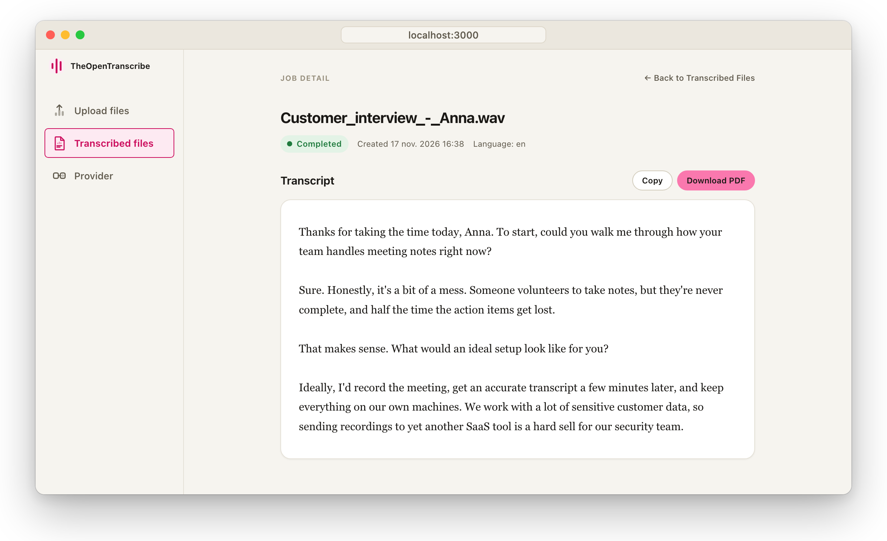

<p align="center">
  <picture>
    <source media="(prefers-color-scheme: dark)" srcset=".github/assets/logo-dark.svg">
    
  </picture>
</p>

<p align="center">Self-hosted audio &amp; video transcription.</p>

<p align="center">
  <a href="https://github.com/AssilAlda/TheOpenTranscribe/releases/latest"></a>
  <a href="https://github.com/AssilAlda/TheOpenTranscribe/actions/workflows/ci.yml"></a>
  <a href="LICENSE"></a>
</p>

<p align="center">
  
</p>

---

### Installation

```bash
curl -fsSL https://raw.githubusercontent.com/AssilAlda/TheOpenTranscribe/main/install.sh | bash
```

Requires [Docker](https://www.docker.com/products/docker-desktop). The app opens at **http://localhost:3000**. Click **Provider**, add your [OpenAI API key](https://platform.openai.com/api-keys), and upload a file.

> [!TIP]
> Run the same command again to update. Your transcripts are kept.

New to the terminal? Follow the [step-by-step guide](docs/getting-started.md).

#### Installation directory

The install script sets everything up in `~/theopentranscribe`.

| Action | Command |
|---|---|
| Stop | `cd ~/theopentranscribe && docker compose down` |
| Start | `cd ~/theopentranscribe && docker compose up -d` |
| Update | Run the install command again |

### Features

- **Private.** Runs on your computer. Recordings and transcripts never leave it, except the audio sent to OpenAI for transcription.
- **Accurate.** Uses OpenAI's `gpt-4o-transcribe` with your own API key.
- **Audio and video.** MP3, MP4, M4A, WAV, WEBM, MPEG and MPGA up to 100 MB. Long recordings are split up and stitched back together automatically.
- **Export.** Read, copy, or download every transcript as a PDF.
- **CLI included.** Transcribe files or whole folders from the terminal with [`packages/transcriber`](packages/transcriber).

### Security

The app has no login and only accepts connections from your own computer by default. Don't expose it to the internet without a VPN or an authenticating reverse proxy. See [SECURITY.md](SECURITY.md) to report a vulnerability.

### Documentation

- [Getting started](docs/getting-started.md)
- [Troubleshooting](docs/troubleshooting.md)

### Contributing

Interested in contributing? Read the [contributing guide](CONTRIBUTING.md) before opening a pull request.

### License

[MIT](LICENSE)
