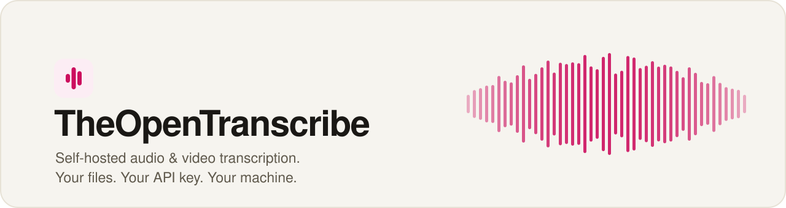
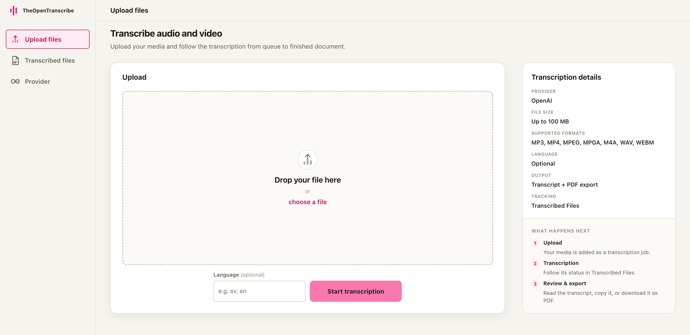
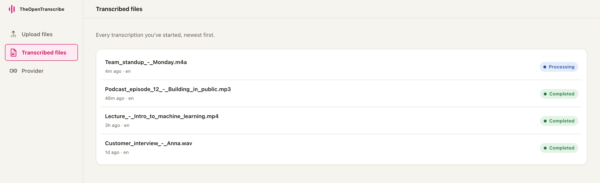
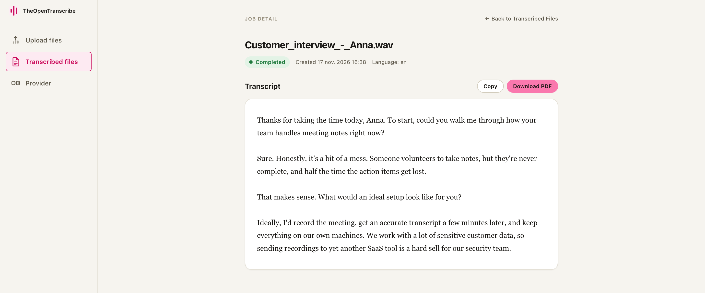
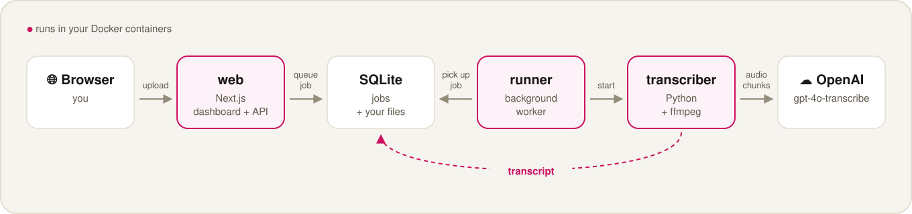

<div align="center">

<picture>
  <source media="(prefers-color-scheme: dark)" srcset=".github/assets/banner-dark.svg">
  
</picture>

<br>
<br>

[](https://github.com/AssilAlda/TheOpenTranscribe/actions/workflows/ci.yml)
[](LICENSE)


**Upload an audio or video file, get a clean transcript back.**<br>
Read it, copy it, or save it as a PDF — all from an app that runs on your own computer.

[**Quick start**](#-quick-start) · [Features](#-features) · [Screenshots](#-screenshots) · [Troubleshooting](#-troubleshooting) · [Security](#-security) · [Contributing](#-contributing)

</div>

<br>

## ✨ Features

<table>
  <tr>
    <td width="33%" valign="top">
      <h3>🏠 Runs on your machine</h3>
      Your recordings and transcripts are stored locally. No accounts, no cloud dashboard, no third-party storage.
    </td>
    <td width="33%" valign="top">
      <h3>🎯 High accuracy</h3>
      Powered by OpenAI's <code>gpt-4o-transcribe</code>, using your own API key — you only pay OpenAI for what you use.
    </td>
    <td width="33%" valign="top">
      <h3>🎬 Audio &amp; video</h3>
      MP3, MP4, M4A, WAV, WEBM, MPEG and MPGA, up to 100 MB. Long recordings are split automatically and stitched back together.
    </td>
  </tr>
  <tr>
    <td width="33%" valign="top">
      <h3>📄 Copy or export to PDF</h3>
      Read the transcript in a clean reader view, copy it with one click, or download a nicely formatted PDF.
    </td>
    <td width="33%" valign="top">
      <h3>📊 Live job tracking</h3>
      Every upload becomes a job you can follow from <em>Queued</em> → <em>Processing</em> → <em>Completed</em>.
    </td>
    <td width="33%" valign="top">
      <h3>⌨️ Terminal mode</h3>
      Prefer the command line? Transcribe single files or whole folders with the built-in CLI.
    </td>
  </tr>
</table>

## 📸 Screenshots

<table>
  <tr>
    <td colspan="2"></td>
  </tr>
  <tr>
    <td width="50%"></td>
    <td width="50%"></td>
  </tr>
  <tr>
    <td align="center"><sub><b>Transcribed files</b> — follow every job's status</sub></td>
    <td align="center"><sub><b>Transcript</b> — read, copy or download as PDF</sub></td>
  </tr>
</table>

## 🚀 Quick start

> [!NOTE]
> **You need two things:**
> 1. **Docker**, installed and running: [Docker Desktop](https://www.docker.com/products/docker-desktop) or [OrbStack](https://orbstack.dev) on Mac, [Docker Engine](https://docs.docker.com/engine/install) on Linux, Docker Desktop on Windows.
> 2. **An OpenAI API key**: create one at [platform.openai.com/api-keys](https://platform.openai.com/api-keys).

**Install with one command.** Paste this into your terminal:

```bash
curl -fsSL https://raw.githubusercontent.com/AssilAlda/TheOpenTranscribe/main/install.sh | bash
```

That's it. The app opens at **http://localhost:3000**. Click **Provider**, paste your API key, and upload a file. 🎉

<details>
<summary><b>🔍 What does the installer do?</b></summary>

<br>

It never asks for your password and installs nothing outside one folder. It:

1. Checks that Docker is installed and running, and tells you how to fix it if not.
2. Creates `~/theopentranscribe` with a `docker-compose.yml` and a `.env` settings file.
3. Downloads the prebuilt app images from GitHub Container Registry. Nothing is built on your computer.
4. Starts the app, waits until it's ready, and opens it in your browser.

Run the same command again at any time to **update**. Your transcripts and settings are kept.

Prefer to read it first? [`install.sh`](install.sh) is short and commented.

</details>

<details>
<summary><b>👣 New to the terminal? Step-by-step guide</b></summary>

<br>

**Step 1. Install Docker.** Install Docker Desktop or OrbStack (see the note above) and open it. Wait until it says it's running.

**Step 2. Open a terminal.**
- **Mac:** press <kbd>⌘</kbd> + <kbd>Space</kbd>, type **Terminal**, press <kbd>Enter</kbd>.
- **Windows:** install [WSL](https://learn.microsoft.com/windows/wsl/install), turn on *WSL integration* in Docker Desktop's settings, then open **Ubuntu** from the Start menu.
- **Linux:** open your terminal app.

**Step 3. Paste the install command** from above and press <kbd>Enter</kbd>. The first time takes a minute or two while the app downloads.

**Step 4. Add your API key.** In the app that opens, click **Provider**, paste your OpenAI API key and click **Save**.

**Step 5. Transcribe a file.** Click **Upload files**, choose an audio or video file (up to 100 MB), then open **Transcribed files** to see the result.

</details>

<details>
<summary><b>🛠️ Developers: build from source instead</b></summary>

<br>

```bash
git clone https://github.com/AssilAlda/TheOpenTranscribe.git && cd TheOpenTranscribe
cp .env.example .env
docker compose up -d --build
```

See [CONTRIBUTING.md](CONTRIBUTING.md) for running the packages without Docker.

</details>

### Stop, start and update

| What you want | Command |
|---|---|
| ⏹️ Stop the app | `cd ~/theopentranscribe && docker compose down` |
| ▶️ Start it again | `cd ~/theopentranscribe && docker compose up -d` |
| 🔄 Update to the latest version | Run the install command again |
| 📌 Install a specific version | `curl -fsSL …/install.sh \| THEOPENTRANSCRIBE_VERSION=1.0.0 bash` |

> [!TIP]
> Your transcripts are kept in a Docker volume, so they are still there after you stop, restart or update the app.

## 🛟 Troubleshooting

<details>
<summary><b>"Docker is not installed" or "Docker is installed but not running"</b></summary>
<br>

Install Docker Desktop or OrbStack, open it, wait until it's running, and run the install command again.

If you use Colima:

```bash
colima start
docker context use colima
```

</details>

<details>
<summary><b>"Port 3000 is already used by another program"</b></summary>
<br>

Something else is using port 3000. Install on another port instead:

```bash
curl -fsSL https://raw.githubusercontent.com/AssilAlda/TheOpenTranscribe/main/install.sh | THEOPENTRANSCRIBE_PORT=3001 bash
```

The app then opens at http://localhost:3001.

</details>

<details>
<summary><b>"no configuration file provided"</b></summary>
<br>

You're not in the app folder. Run `cd ~/theopentranscribe` first, then try again.

</details>

<details>
<summary><b>A file stays on "Queued"</b></summary>
<br>

The background worker isn't running. Run `cd ~/theopentranscribe && docker compose ps` and check that both **web** and **runner** are running. Running the install command again restarts anything that stopped.

</details>

<details>
<summary><b>A file ends as "Failed"</b></summary>
<br>

Your API key is probably missing or wrong. Open **Provider** and check your key.

</details>

## 🔒 Security

> [!IMPORTANT]
> **TheOpenTranscribe has no login.** It's built for one person on their own computer.
> - By default it only accepts connections from **your own computer** (`127.0.0.1`).
> - To use it from other devices on your home network, set `THEOPENTRANSCRIBE_BIND=0.0.0.0` in `~/theopentranscribe/.env` and run the install command again. Anyone who can reach the app can use your API key.
> - **Never expose it to the internet** without extra protection, such as a VPN or a reverse proxy with login.

> [!WARNING]
> Your API key is stored as plain text on your computer (in a file only your user can read). Treat the machine accordingly.

Found a vulnerability? Please report it privately — see [SECURITY.md](SECURITY.md).

## 🧩 How it works

<picture>
  <source media="(prefers-color-scheme: dark)" srcset=".github/assets/architecture-dark.svg">
  
</picture>

| Package | What it does |
|---|---|
| [`packages/web`](packages/web) | Next.js dashboard and HTTP API |
| [`packages/runner`](packages/runner) | Background worker that picks up queued jobs |
| [`packages/transcriber`](packages/transcriber) | Python transcription engine and CLI |
| [`packages/db`](packages/db) | SQLite storage for jobs |
| [`packages/provider-config`](packages/provider-config) | Safe storage of the API key |
| [`packages/contract`](packages/contract) | Shared JSON job format |

## ⌨️ Use it from the terminal

Don't want the web app? The transcription engine also works as a standalone CLI:

```bash
theopentranscribe path/to/recording.mp4 --language en
```

See [`packages/transcriber/README.md`](packages/transcriber/README.md) for setup.

## 🤝 Contributing

Contributions are welcome! Read [CONTRIBUTING.md](CONTRIBUTING.md) to get set up, and please follow the [Code of Conduct](CODE_OF_CONDUCT.md).

Bugs and ideas → [open an issue](https://github.com/AssilAlda/TheOpenTranscribe/issues/new/choose).

## 📄 License

[MIT](LICENSE) © Assil Alda

<div align="center">
<br>
<sub>If TheOpenTranscribe is useful to you, a ⭐ on GitHub helps others find it.</sub>
</div>
